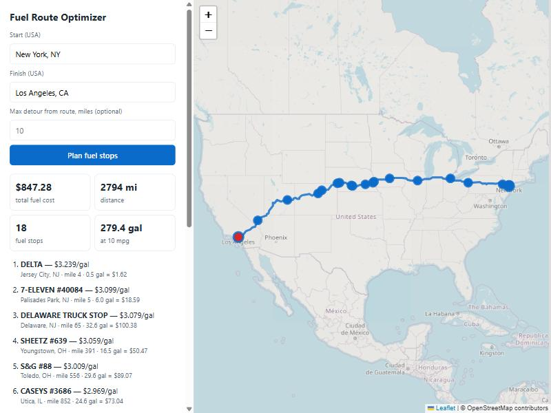

# Fuel Route Optimizer

A Django REST API that plans a truck trip between two US locations. It returns the driving route, the cheapest set of fuel stops along it, and the total fuel cost. The truck has a 500-mile range and gets 10 mpg.

- **One routing call per trip.** Geocoding plus routing makes at most 3 external calls, and repeat trips make none (everything is cached).
- **Fast.** About 10–200 ms when cached, including a coast-to-coast trip. The first time a trip is requested it takes about 2–5 s, almost all of it spent waiting for the public routing server.
- **A real optimizer.** It uses the greedy "gas station problem" algorithm, which gives the cheapest plan. A randomised test checks it against an exact dynamic program.
- **Map output.** Each response includes GeoJSON and an encoded polyline. There is also an HTML page that draws the route on a Leaflet map.



---

## Contents

1. [Quick start](#quick-start)
2. [API](#api)
3. [How it works](#how-it-works)
4. [Design decisions and trade-offs](#design-decisions-and-trade-offs)
5. [Testing](#testing)
6. [Project layout](#project-layout)

## Quick start

Requires Python 3.12+.

```bash
python -m venv .venv
source .venv/bin/activate            # Windows: .venv\Scripts\activate
pip install -r requirements.txt

python manage.py migrate
python manage.py load_stations       # ~1 s, offline: CSV + committed geocode cache
python manage.py runserver
```

Then open:

- Map UI: <http://127.0.0.1:8000/api/route/map/?start=New+York,+NY&finish=Los+Angeles,+CA>
- JSON API: <http://127.0.0.1:8000/api/route/?start=New+York,+NY&finish=Los+Angeles,+CA>
- Postman: import [`postman/fuel-route-optimizer.postman_collection.json`](postman/fuel-route-optimizer.postman_collection.json)

No API keys are needed. All the external services are free and keyless.

| Environment variable | Default | Purpose |
| --- | --- | --- |
| `DJANGO_SECRET_KEY` | dev key | Set this in production |
| `DJANGO_DEBUG` | `true` | |
| `DJANGO_ALLOWED_HOSTS` | `localhost,127.0.0.1` | Comma-separated |
| `DJANGO_CACHE_DIR` | `.cache/` | File cache for geocodes and routes |
| `OSRM_URL` | `https://router.project-osrm.org` | Point to a self-hosted OSRM |
| `NOMINATIM_URL` / `PHOTON_URL` | public instances | Geocoders |
| `FORCE_IPV4` | `true` | Sends outbound HTTP over IPv4 only. This avoids ~20 s stalls on hosts with broken IPv6 |

## API

### `POST /api/route/` (or `GET` with query parameters)

| Field | Type | Required | Description |
| --- | --- | --- | --- |
| `start` | string | yes | A US address, city (`"Chicago, IL"`) or `"lat,lon"` |
| `finish` | string | yes | Same formats as `start` |
| `max_detour_miles` | number | no | How far from the route a station may be, 1–50. Default 10 |

```bash
curl -X POST http://127.0.0.1:8000/api/route/ \
  -H "Content-Type: application/json" \
  -d '{"start": "Chicago, IL", "finish": "St. Louis, MO"}'
```

Response (`200 OK`; the geometry is shortened here):

```json
{
  "start":  {"query": "Chicago, IL", "label": "Chicago, South Chicago Township, Cook County", "lat": 41.875562, "lon": -87.624421},
  "finish": {"query": "St. Louis, MO", "label": "Saint Louis, Missouri, United States", "lat": 38.625406, "lon": -90.190009},
  "summary": {
    "total_distance_miles": 295.9,
    "estimated_drive_time_hours": 5.6,
    "total_fuel_cost": 91.53,
    "total_gallons": 29.59,
    "average_price_per_gallon": 3.0931,
    "number_of_stops": 2,
    "vehicle": {"max_range_miles": 500.0, "mpg": 10.0, "tank_gallons": 50.0},
    "max_detour_miles": 10.0,
    "stations_considered": 97,
    "compute_time_ms": 12.0
  },
  "fuel_stops": [
    {
      "stop_number": 1, "opis_id": 73127, "name": "Gas N Wash",
      "address": "I-55, EXIT 285", "city": "Chicago", "state": "IL",
      "lat": 41.83705, "lon": -87.68494,
      "price_per_gallon": 3.399, "route_mile": 5.0, "distance_from_route_miles": 0.2,
      "fuel_on_arrival_gallons": 0.0, "gallons_purchased": 1.3, "cost": 4.42
    },
    {
      "stop_number": 2, "opis_id": 72438, "name": "QUIKTRIP #7208",
      "address": "I-290 EXIT 18A", "city": "Bellwood", "state": "IL",
      "lat": 41.8829, "lon": -87.87617,
      "price_per_gallon": 3.079, "route_mile": 13.0, "distance_from_route_miles": 6.9,
      "fuel_on_arrival_gallons": 0.0, "gallons_purchased": 28.29, "cost": 87.11
    }
  ],
  "route": {
    "polyline": "gyq~FdcyuO|EC`@zSzmB}AzGlQpLO@pFxXE~C|B~...",
    "geojson": {
      "type": "FeatureCollection",
      "features": [
        {"type": "Feature", "geometry": {"type": "LineString", "coordinates": [[-87.62435, 41.87556], "..."]}, "properties": {"kind": "route"}},
        {"type": "Feature", "geometry": {"type": "Point", "coordinates": [-87.624421, 41.875562]}, "properties": {"kind": "start", "label": "..."}},
        {"type": "Feature", "geometry": {"type": "Point", "coordinates": [-87.68494, 41.83705]}, "properties": {"kind": "fuel_stop", "stop_number": 1, "...": "..."}}
      ]
    }
  },
  "map_url": "http://127.0.0.1:8000/api/route/map/?start=Chicago%2C+IL&finish=St.+Louis%2C+MO"
}
```

- `route.geojson` is a standard FeatureCollection. You can paste it into <https://geojson.io>. It holds the route `LineString`, the start and finish points and one point per fuel stop.
- `route.polyline` is the same line as a [Google encoded polyline](https://developers.google.com/maps/documentation/utilities/polylinealgorithm) (precision 5).
- `map_url` opens the same plan on a Leaflet map.

**Errors.** Every error has the shape `{"detail": "..."}`, except field validation errors, which name the field.

| Status | When |
| --- | --- |
| `400` | Missing or invalid fields, or a location that is not found in the USA |
| `422` | No drivable route, or a gap between stations longer than 500 miles. Try a larger `max_detour_miles` |
| `502` | The routing or geocoding service is unavailable |

### `GET /api/route/map/?start=…&finish=…[&max_detour_miles=…]`

Shows an HTML page with a form, the trip summary, the list of stops and a Leaflet map of the route and stops. Without parameters it shows only the form.

### `GET /api/health/`

Returns `{"status": "ok", "stations_loaded": 6621}`.

## How it works

```
start, finish ──► geocode (Nominatim → Photon fallback, cached)        ≤ 2 calls
              ──► route   (OSRM, full geometry, one call, cached)      ≤ 1 call
              ──► corridor search over the in-memory station index      numpy, ~10–50 ms
              ──► greedy optimizer                                      < 5 ms
              ──► response (summary, stops, GeoJSON, polyline, map URL)
```

### 1. Station data, prepared offline

The price list (`data/fuel-prices.csv`, 8,151 rows) has the truck-stop name, a highway or exit description, the city, the state and the price. It has **no coordinates**, so stations are placed at their city's centroid:

- `manage.py geocode_cities` resolves each of the 3,808 distinct US `(city, state)` pairs once. It first uses the **US Census Bureau Gazetteer** (places, then county subdivisions; public domain, offline), which matches 97%. The remaining 131 names go to **Nominatim** at 1 request per second. 4 stay unresolved.
- The result is committed as `data/city_geocodes.json`. Nobody needs to run this step again unless the price list gains new cities.
- `manage.py load_stations` loads the CSV and the cache into the `FuelStation` table in about a second. Canadian rows (AB, BC, ON, …) are dropped because the API only covers the USA. Rows that repeat an OPIS ID (the same stop listed twice) are merged, and the merged stop keeps the lowest price. This leaves **6,626 stations, 6,621 with coordinates**.

### 2. Route

The trip makes one OSRM `route` call with `overview=full`, so the full road geometry is available for matching stations. The response also includes a copy of the geometry simplified with Ramer–Douglas–Peucker (about 55 m tolerance). For New York → Los Angeles this cuts about 35,000 points to about 2,600. Both the route and the simplified copy are cached.

### 3. Stations along the route

All geocoded stations are held in memory as numpy arrays, loaded once per process. For each route:

1. A bounding-box filter keeps only stations near the route's extent.
2. A coarse pass against route points every 20 miles discards anything clearly too far away.
3. A fine pass against route points every 1 mile gives each remaining station its **distance from the route** and its **mile marker** along it. Distances use a local equirectangular projection, which is accurate to well under 1% at these distances.

Stations within `max_detour_miles` (default 10) are candidates. Their mile markers are scaled so they agree with OSRM's road distance.

### 4. Optimizer

The route becomes a line from mile 0 to mile *D*, with candidate stations at known positions and prices. The tank holds 500 / 10 = 50 gallons. Standing at a station, the optimizer does the following:

1. If a **cheaper** station is within one tank's range, it buys just enough fuel to reach the *first* such station and drives there.
2. Otherwise, if the destination is within range, it buys just enough to finish.
3. Otherwise it **fills the tank** and drives to the cheapest station in range.

This is the textbook algorithm for the fixed-route gas station problem, and it is optimal. Every mile is fuelled at the cheapest price that can cover it: you never carry fuel past a cheaper station, and you leave a station that is the cheapest in range with as much of its fuel as fits. The test suite checks this. On 300 random instances it compares the greedy plan with an exact dynamic program over discretised fuel levels, and both the costs and the infeasible cases match. The optimizer runs in O(n·k) time, where k is the number of stations within one tank-range.

**Assumptions**

- The truck **starts with an empty tank** and finishes empty, so the plan pays for exactly `distance / 10` gallons. The few miles from the origin to the first station on the route are charged at that station's price. This way short trips also return a real cost.
- Prices are per gallon. Small detours off the route to reach a station are not added to the distance or the fuel used. Each stop reports `distance_from_route_miles` so the detour is visible.
- If no station falls within the corridor for more than 500 miles, the API returns `422` with the gap location. Raising `max_detour_miles` widens the search.

## Design decisions and trade-offs

| Decision | Why |
| --- | --- |
| **OSRM** for routing | Free and keyless. A single call covers a coast-to-coast trip (Valhalla's public server caps a request at about 1,500 km). |
| **Nominatim first, Photon fallback** for user input | Both are free and keyless and filtered to the USA. Whichever answers is cached for a week. `"lat,lon"` input skips geocoding entirely. |
| **City-level station locations** | The CSV gives highway-exit descriptions such as `I-44, EXIT 283 & US-69`, which free geocoders cannot resolve reliably. City centroids from the Census are deterministic and need no network. The cost is a few miles of position error, which the 10-mile default corridor absorbs. |
| **Geocoding offline, committed cache** | API requests never geocode stations. Setup has no rate limits and gives the same result every time. |
| **In-memory numpy index instead of PostGIS** | About 6,600 points fit easily in memory, and vectorised distance maths takes milliseconds. SQLite keeps setup to a single command. With much larger data, PostGIS (`ST_DWithin` on a geography index) would be the next step. |
| **File-based cache** | Cached results survive restarts with no extra services. In production, switch the `CACHES` setting to Redis or Memcached. |
| **Greedy algorithm instead of a general LP** | It is optimal for this exact problem, simple to explain, and fast. |
| **Lowest price for repeated OPIS IDs** | The duplicates are the same physical stop, so the truck would pay the posted lower price. |

**Known limitations and next steps**

- Pure cost minimisation can produce many short stops, for example a 1-gallon top-up just before a cheaper station. If fewer stops matter, a fixed cost per stop could be added. That variant would need DP rather than greedy.
- Station positions are only as accurate as the city centroid. Geocoding each exit, for instance with OSM motorway-junction data, would make detours exact.
- The public OSRM and Nominatim servers are demo services. For production traffic, self-host them or use a commercial provider. Only the URLs need to change.

## Testing

```bash
python manage.py test
```

There are 35 tests, and none of them touch the network (external calls are mocked):

- **Optimizer**: hand-checked cases (top-up versus fill-up, lead-in billing, infeasible gaps) and the randomised comparison with an exact DP.
- **Geometry and corridor**: haversine, polyline encoding against Google's reference example, RDP simplification, corridor selection and mile markers.
- **Clients**: coordinate input, filtering to the USA, cache hits, geocoder fallback, OSRM parsing and error mapping.
- **API**: the end-to-end plan through DRF, validation, `422` on gaps, the map page and the health check.
- **Data loading**: de-duplication, dropping Canadian rows, unresolved cities and Gazetteer name matching.

GitHub Actions runs the suite on every push and pull request (`.github/workflows/ci.yml`).

## Project layout

```
config/                 Django settings and root URLs
stations/
  models.py             FuelStation
  geocoding.py          CSV parsing, Census Gazetteer matching, Nominatim fallback
  index.py              in-memory numpy station index
  management/commands/  geocode_cities (offline, one-off), load_stations
routes/
  clients.py            cached geocoding (Nominatim/Photon) and routing (OSRM)
  corridor.py           stations within N miles of the route, with mile markers
  optimizer.py          greedy cost-optimal refuelling
  planner.py            orchestration and response building
  views.py, urls.py     DRF endpoint, map page, health
  templates/routes/map.html  Leaflet map
data/
  fuel-prices.csv       the provided price list
  city_geocodes.json    committed city geocode cache
postman/                Postman collection
```
